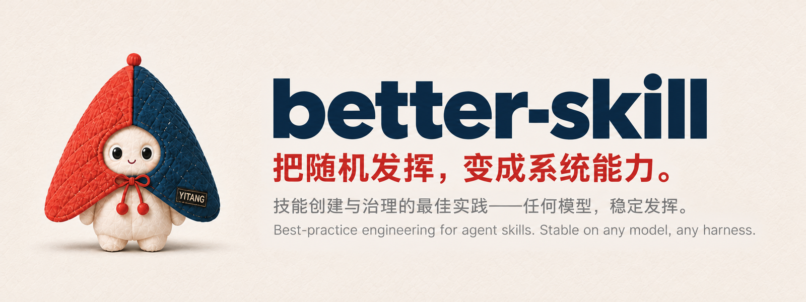
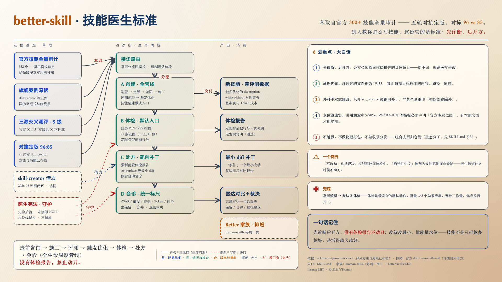
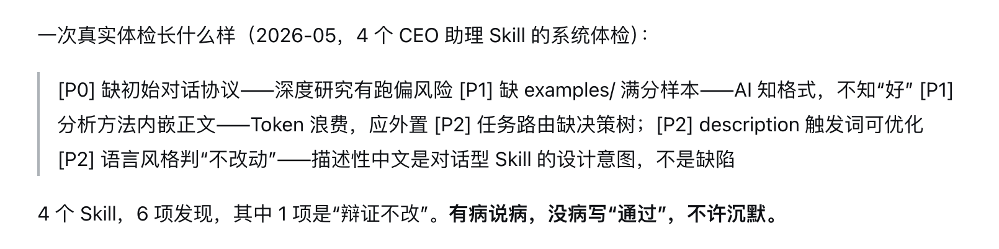
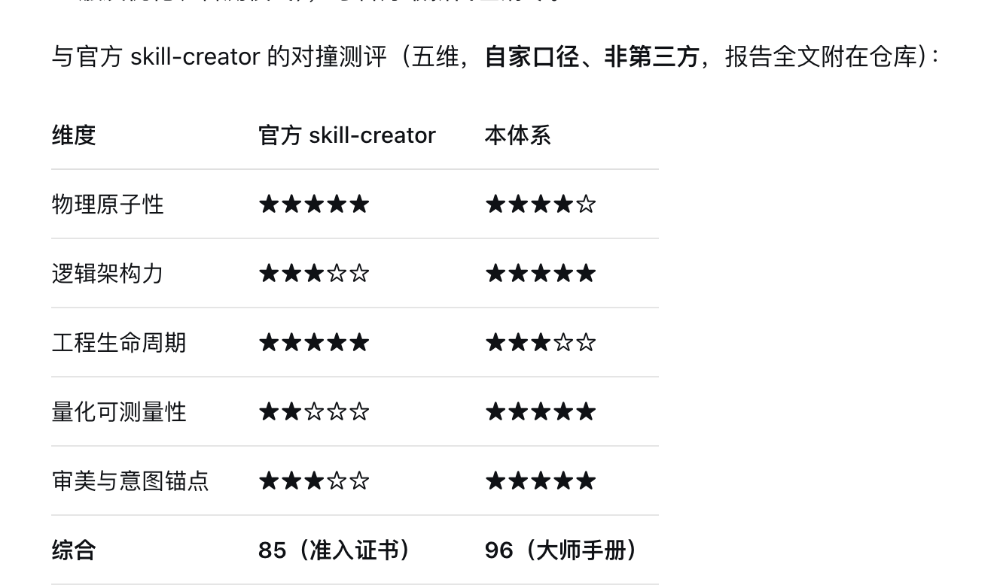

<p align="center"></p>

# better-skill

<p align="center">
  <a href="CHANGELOG.md"></a>
  <a href="LICENSE"></a>
  <a href="references/provenance.md"></a>
  <a href="references/checklist.md"></a>
  <a href="references/provenance.md"></a>
  
</p>

> **The doctor's manual for AI agent skills.**
> An evidence-based standard to select, audit, score, and build skills — distilled from a full audit of 300+ official skills.

**🇺🇸 English** | [🇨🇳 中文](README.md)

---

The more skills your agent has, the more it needs a doctor.

Most skill repos teach you *how to write a skill*. This one holds you to a standard: which architecture to pick **before** building, what a healthy skill looks like on the inside, and how to prove — with numbers — that one skill is better than another.



## Why you need this

**You may have written dozens of skills — and never given any of them a real checkup.**

Three scenes you probably recognize:

1. **Skills ship without ever being examined.** Bloated descriptions, methods inlined into the body, missing examples — chronic diseases. When they flare up, all you feel is "this skill sucks" without being able to name the lesion.
2. **Triggering is voodoo.** It stays silent when it should fire; it fires when it should stay silent. Almost nobody measures trigger rate — this standard turns description-triggering into a quantified, iteratively optimizable engineering problem.
3. **"My skill is better than yours" — comparison without a shared yardstick is just an argument.** The 5-dimension rubric (ZSAR / trigger rate / round-trips / token cost / autonomy level) gives comparisons a referee.

## Up and running in 30 seconds

```bash
# 1. Clone into your skills directory (any harness that loads SKILL.md-style skills)
git clone https://github.com/YTruman/better-skill.git <your-skills-dir>/better-skill
```

```text
2. Tell your agent:
   "Use better-skill to give my <skill> a checkup"
3. You get back: an audit report with evidence line numbers
```

(Coming) one-line install and a YAI CLI distribution channel — install once, keep the updates.

## Four clinics, one pipeline

| Mode | You say… | What happens | What you get |
|---|---|---|---|
| **Create** | "I want a new skill" | paradigm selection → freedom grading → directory blueprint → build → eval loop → trigger tuning | a new skill with eval data attached |
| **Checkup** | "audit this skill" | 4-layer P0/P1/P2 scan + Not-To-Do red lines | audit report: every finding with line numbers and priority |
| **Prescription** | "improve this skill" | fresh audit report first → surgical `str_replace`-level patches only | minimal diffs + before/after re-check |
| **Consult** | "which skill is better?" | unified 5-dimension rubric | radar comparison + keep/merge/retire advice |

Core discipline: **diagnose first, treat second. No audit report, no surgery.** A prescription that cannot point back to a specific checklist item is malpractice.

## What a real checkup looks like

See [`examples/perfect-audit-report.md`](examples/perfect-audit-report.md): a real 4-skill checkup that surfaced 6 findings (full list in provenance §4; the example file shows the report format in excerpt) — from a P0 "missing initial conversation protocol" (direction-drift risk) down to one deliberate *"do not change"* call (descriptive Chinese was the design intent, not a defect).



The author's own use: turning it loose on skills he had previously built in Codex and Claude Code — cold sweat. One skill that an agent had self-reviewed several times and considered perfect still failed the checkup: missing initial conversation protocol, missing trigger keywords, missing task routing. "No wonder my workflows kept being unstable."

Knowing when **not** to operate is the doctor's signature move.

## Why trust this standard

- **Full audit of 332 official skills** — invocation patterns catalogued one by one, priorities ranked from real usage, not taste.
- **Replicable research method**: a focused 12-hour study in five steps — learn the official skill-creator word by word → tear down a dozen officially recommended best-practice skills → consolidate engineering paradigms → blind cross-review of three sources → blind-test the packaged result on real cases, scoring and stability clearly ahead;
- **Flagship teardowns**: skill-creator, doc-coauthoring, canvas-design, mcp-builder, webapp-testing, and more.
- **5 rounds of adversarial polishing** — the standard was stress-tested into shape, not written in one sitting.
- **Scored head-to-head**: 5-dimension structured comparison against the official skill-creator — composite **96 vs 85**.

> **How to read those numbers (honesty box)**: the five dimensions (physical atomicity / logical architecture / engineering lifecycle / quantitative measurability / aesthetics & intent anchoring) are structured star ratings; 96/85 is a composite conversion score for **same-rubric relative comparison**, not laboratory-grade measurement. Full scoring tables, the head-to-head process and the absorbed official details live in [`references/provenance.md`](references/provenance.md) — recalculate them against the same rubric if you doubt them.



## Relationship to the official skill-creator

**Complementary, not a replacement.** The official one certifies "you can build one that runs" (admission license); this standard judges "how well built, how long it lives" (master's manual). The evaluation stage directly adopts the official 2026-08 "Test, measure, and refine" loop (with/without comparison, assertion scoring, trigger optimization), and four engineering details have been absorbed back from it.

## What's inside

```
SKILL.md                    # router + doctor's constitution (start here)
references/principles.md    # token economics, freedom matching, cognitive grounding
references/paradigms.md     # 7 architecture paradigms + selection decision tree
references/checklist.md     # 4-layer P0/P1/P2 checklists + Not-To-Do red lines + report template
references/metrics.md       # ZSAR / trigger rate / round-trips / token / autonomy rubrics
references/templates.md     # full document templates + Anti-Slop word list
references/eval-loop.md     # with/without eval, assertion scoring, trigger optimization
references/provenance.md    # the evidence chain: audits, scores, 5-round evolution
examples/                   # a perfect audit report, annotated
```

## FAQ

**Which environments?** Any agent harness that loads SKILL.md-style skills (Claude Code and friends).

**Does it work for non-English skills?** Yes — the standard itself is written in Chinese and battle-tested on Chinese skills first; the trigger-optimization method works for any language's descriptions.

**I only have one skill. Worth a checkup?** Yes. A single-skill checkup takes about fifteen minutes, and P0 findings (missing initial protocol, missing examples) are usually fixable on the spot.

**Does it really guarantee 90 points?** That's the design goal, not a promise: independent of base model and harness, hold packaging quality at a 90-point waterline. Don't take our word — run your own re-test and cross-comparison (method in `references/eval-loop.md`).

**Can it build a skill from scratch?** Yes. "Create" mode is the full pipeline: paradigm → blueprint → build → eval → trigger tuning, and the resulting skill ships with its own eval data.

## The Better family & roadmap

This repo is one position on an org chart: [truman-skills](https://github.com/YTruman/truman-skills) — *the job-description sheet of an AI business-management team* (goes public together with this repo). First positions: `better-pk` (controlled-comparison discipline), `deep-debug` (scientific debugging). One new position every week.

Selection rule: **effective enough, scarce enough, best-practice enough** — the star count is the shipping speed.

## Author

**YTruman** — CEO @ Yitang, a research lab disguised as an education company. Y = Y-type entrepreneur. I've spent 9 years researching the scientific principles of business.

## License

[MIT](LICENSE)
